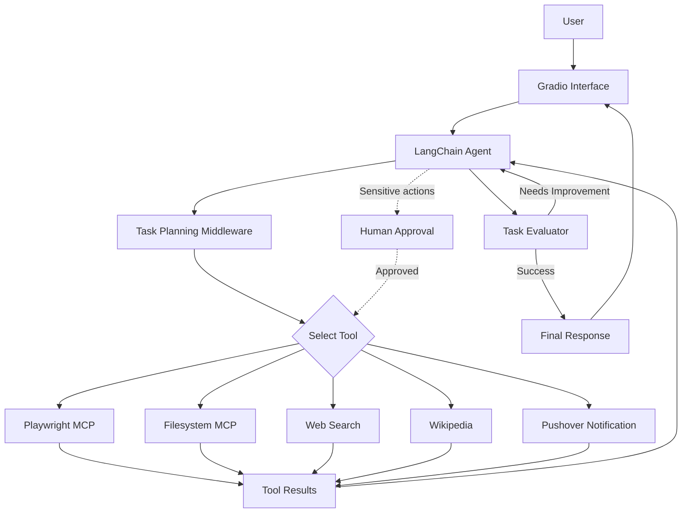

# Sidekick AI — An Agentic AI Task Assistant

An AI-powered personal assistant that plans and executes multi-step tasks using LLMs, browser automation, MCP tools, web search, and human-in-the-loop approval.

> **Deployment status: Intentionally not publicly deployed.**  
> Sidekick AI was briefly deployed for testing, but the public service was removed after evaluating the security and resource implications of exposing a tool-using AI agent. The project is maintained as a local application while its security requirements are considered.

## Overview

Sidekick AI explores how to build an AI agent that goes beyond generating text. Instead of responding only with an answer, it can use tools, interact with external environments, work through multi-step tasks, and evaluate whether its objective has been achieved.

Built with LangChain and LangGraph, the application combines an LLM-powered worker, tool integrations, task planning, evaluation, and human approval into a single Gradio interface.

The project focuses on a central question:

**How do we build AI agents that can take useful actions while keeping their behavior observable and under human control?**

## Features

- **Agentic task execution:** Uses an LLM-powered agent to work through user-defined tasks.
- **Browser automation:** Uses Playwright through the Model Context Protocol (MCP) to interact with web pages.
- **MCP tool integration:** Connects the agent to external capabilities, including browser automation and filesystem operations.
- **Web search and research:** Uses web search and Wikipedia tools to gather information.
- **Task planning:** Uses task-planning middleware to organize multi-step work.
- **Evaluation and retry loop:** Evaluates task outcomes against success criteria and can retry unsuccessful attempts with feedback.
- **Human-in-the-loop approval:** Pauses for human intervention before configured sensitive tool actions, such as sending notifications.
- **Push notifications:** Integrates with Pushover to send notifications.
- **Error handling:** Uses custom middleware to handle tool errors and return useful error messages.
- **Conversation checkpointing:** Uses LangGraph's in-memory checkpointing for agent execution state.
- **Interactive UI:** Provides a Gradio interface for interacting with the agent and monitoring task progress.

## Tech Stack

| Technology | Purpose |
|---|---|
| Python | Application logic |
| LangChain | LLM integration and agent tooling |
| LangGraph | Agent execution, checkpointing, and workflow control |
| Gradio | Interactive user interface |
| Playwright MCP | Browser automation |
| Filesystem MCP | Filesystem operations |
| MixRoute / DeepSeek V4 Flash | LLM inference |
| Serper | Web search |
| Wikipedia | Reference information |
| Pushover | Push notifications |
| Pydantic | Structured evaluator output |

## Architecture



The agent uses tools to interact with its environment and receives their results before continuing. An evaluator checks the result against the task's success criteria. If the task is unsuccessful and retry attempts remain, feedback can be passed back to the worker.

Human approval is configured for selected actions. It should not be interpreted as a guarantee that every possible action is safe.

## How the Agent Works

1. **Task input:** The user submits a task and, where applicable, defines success criteria.
2. **Planning and execution:** The agent determines how to approach the task and selects from its available tools.
3. **Tool interaction:** The agent can search the web, consult Wikipedia, use browser automation, interact with the filesystem, or send configured notifications.
4. **Human intervention:** Configured actions can trigger an approval request before execution continues.
5. **Evaluation:** The evaluator assesses whether the task meets its success criteria.
6. **Retry or completion:** The worker may receive feedback and try again, subject to the configured attempt limit, before returning its result.

## Security and Responsible Deployment

### Why is this project not publicly deployed?

Sidekick AI is an agent that can interact with external websites and execute tool calls. Exposing such an application to untrusted users creates risks that are different from those of a conventional chatbot.

During deployment testing, the application also exceeded the memory limit of the selected Render free instance. More importantly, the deployment process prompted a review of the security implications of making a tool-using agent publicly accessible.

The public service was removed rather than leaving the application exposed without a sufficiently reviewed security model.

### Potential risks

- **Unauthorized usage:** A publicly accessible interface could allow others to submit tasks and consume the owner's model API credits.
- **Prompt injection:** Malicious instructions embedded in user input or retrieved web content could attempt to manipulate the agent's behavior.
- **Unintended browser actions:** An agent with browser access could interact with websites in unexpected ways.
- **Tool misuse:** Filesystem operations and notification integrations introduce additional consequences beyond text generation.
- **Resource exhaustion:** Repeated requests, expensive agent loops, and browser processes could exhaust memory or API quotas.
- **Incomplete approval coverage:** Human-in-the-loop controls protect only the actions and execution paths for which they are configured.

These are potential risks of the application's capabilities, not claims that an attack occurred.

### Setup

Clone the repository:

```bash
git clone <YOUR_GITHUB_REPOSITORY_URL>
cd <YOUR_PROJECT_DIRECTORY>
```

Create and activate a virtual environment:

```bash
python -m venv .venv
```

Windows PowerShell:

```powershell
.\.venv\Scripts\Activate.ps1
```

Install the Python dependencies:

```bash
pip install -r requirements.txt
```

Create a `.env` file locally with the environment variables used by your configuration. Depending on the tools you enable, these include:

```env
MIXROUTE_API_KEY=your_mixroute_api_key
SERPER_API_KEY=your_serper_api_key
PUSHOVER_TOKEN=your_pushover_application_token
PUSHOVER_USER=your_pushover_user_key
```

Never commit real API keys or tokens to version control.

Run the application:

```bash
python app.py
```

Open the local URL printed by Gradio in your terminal.

> Setup details may vary with dependency versions and local browser configuration. Verify the required environment variables against the current source code before running the application.


This project is an exploration of agentic AI architecture, tool integration, workflow orchestration, and responsible deployment—not a claim that autonomous AI systems can be made safe simply by adding an approval step.
